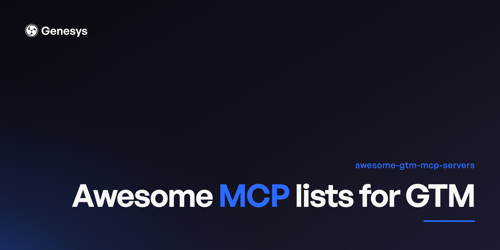

# Awesome GTM MCP Servers 

> Model Context Protocol servers that connect an AI agent to the go-to-market stack: CRM, enrichment, sales, SEO, ads, analytics, lifecycle, and support.

Two things are true about this space and neither is obvious from the existing lists.

**The official-server gap has mostly closed.** The July edition of this list said no first-party MCP server existed for Google Ads, Meta Ads, LinkedIn Ads, Semrush, Mixpanel, Google Search Console, Clay, Hunter, Crustdata, Pipedrive, Close, or Klaviyo. That was already wrong for Google Ads and Pipedrive, and it is wrong for eight more now. Ten of the twelve run an official server today. **LinkedIn Ads** and **Google Search Console** are the two still community-only, so those are the ones to vet hardest before you hand a server an API key and a budget.

**Vendors are migrating to hosted.** Ahrefs, PostHog, and Hunter archived their local repos in favour of remote endpoints, and Salesforce retired its local server for hosted servers and skills. HubSpot, Apollo, and Attio are hosted-first with no meaningful public repo, and nearly every official server added since July is hosted only. A repo-only view of this space is already out of date, so hosted servers are listed here as first-class entries.

The vendor servers added in this edition come from the [GTM Index](https://adamgtm.com/index) in [Adam's GTM Report](https://posts.adamgtm.com/) by Adam Schoenfeld, which tracks which GTM tools ship an MCP server. Each one links to the vendor's own MCP docs. For his agent-readiness scores, see the [GTM Developer Tools map](https://adamgtm.com/gtm-dev).

GitHub entries were re-checked against the live GitHub API on 2026-11-11, and every link was checked the same day. 41 vendor sites block automated checks, so a sample of those was opened by hand. For the vendor servers added from the GTM Index, what was checked is that the vendor's MCP page loads, not every claim on it. Entries are alphabetical within each section. Servers marked **Official** are vendor-maintained; everything else is community-built.

## Contents

- [CRM](#crm)
- [Enrichment and Data](#enrichment-and-data)
- [Sales and Outbound](#sales-and-outbound)
- [SEO and Content](#seo-and-content)
- [Website and Inbound](#website-and-inbound)
- [Analytics and Product](#analytics-and-product)
- [Ads](#ads)
- [Email and Lifecycle](#email-and-lifecycle)
- [Support and Success](#support-and-success)
- [Comms and Ops](#comms-and-ops)
- [Registries](#registries)
- [Known Gaps](#known-gaps)

---

## CRM

- [attio-mcp-server](https://github.com/kesslerio/attio-mcp-server) - The most active community Attio server, covering records, lists, and CRM objects. Attio also runs a hosted server at `https://mcp.attio.com/mcp` ([docs](https://docs.attio.com/mcp/overview)). 68 stars.
- [Clarify MCP](https://clarify.ai/integrations/mcp) - **Official.** Self-updating CRM that logs your emails, calls, and meetings without manual entry.
- [Close MCP Server](https://developer.close.com/mcp) - **Official**, hosted at `mcp.close.com/mcp`. Separate scopes for reading, safe writes, and destructive writes, which is the right shape for a CRM an agent can change. OAuth or API key.
- [close-crm-cli](https://github.com/bcharleson/close-crm-cli) - CLI and MCP server for Close, advertising 160+ commands. Predates Close's official server above and has very low adoption. 1 star.
- [Customermates](https://github.com/customermates/customermates) - Open-source CRM (AGPL-3.0 core, separately licensed commercial features) with a native MCP endpoint at `/api/v1/mcp`. Claude and ChatGPT connect through an OAuth custom connector, Claude Code, Codex and Cursor with an API key. The tools read and write records and relationships, LinkedIn and email conversations and drafts, and wiki pages, and MCP works on every plan including the free one and on self-hosted instances. 221 stars.
- [forcedotcom/mcp-hosted](https://github.com/forcedotcom/mcp-hosted) - **Official.** Salesforce's hosted MCP servers, and the first-party MCP path now that the local CLI server below has reached end of life. Apache-2.0. 136 stars.
- [HubSpot MCP Server](https://developers.hubspot.com/mcp) - **Official**, hosted at `mcp.hubspot.com`. Read and write access to CRM objects (contacts, companies, deals, tickets, quotes) and engagements (calls, emails, meetings, notes), plus read-only marketing data. A separate local Developer MCP Server covers the CLI platform. Note: `HubSpot/mcp-server` exists on GitHub under the real org but is an empty placeholder — do not use it.
- [Lightfield MCP](https://docs.lightfield.app/getting-started/mcp-quickstart/) - **Official.** AI CRM that writes its own records using your calls and inbox, then prospects and coaches.
- [MCP-Salesforce](https://github.com/smn2gnt/MCP-Salesforce) - The most-starred community Salesforce connector after the official one, actively maintained. MIT. 179 stars.
- [mcp-server-salesforce](https://github.com/tsmztech/mcp-server-salesforce) - Community server for querying and manipulating Salesforce records. MIT. 164 stars.
- [Pipedrive MCP Server](https://www.pipedrive.com/en/features/mcp-server) - **Official**, hosted. Read and write access to Pipedrive CRM data over OAuth, on every plan. Launched 30 June 2026. `pipedrive/mcp-server` on GitHub is still a 404; this hosted server is the first-party path.
- [pipedrive-mcp-server (ckalima)](https://github.com/ckalima/pipedrive-mcp-server) - Pipedrive server with 155 contract-tested tools, a v2-first API surface, and gated destructive operations. The strongest community option: more recent than the alternative below and MIT-licensed. 10 stars.
- [pipedrive-mcp-server (WillDent)](https://github.com/WillDent/pipedrive-mcp-server) - The most-starred community Pipedrive server. Last pushed July 2026. 60 stars.
- [Reevo MCP](https://help.reevo.ai/AI-and-productivity/Reevo-MCP) - **Official.** CRM with prospecting, dialing, sequences, and forecasting in one place, meant to replace several sales tools.
- [salesforcecli/mcp](https://github.com/salesforcecli/mcp) - **Official but archived.** Salesforce's local server reached end of life on 2 November 2026; the npm package still installs but gets no more releases. Salesforce now ships its developer tooling as skills in [forcedotcom/sf-skills](https://github.com/forcedotcom/sf-skills). Historical pointer; use the hosted servers above. Apache-2.0. 488 stars.
- [twenty-crm-mcp-server](https://github.com/mhenry3164/twenty-crm-mcp-server) - Server for Twenty, the open-source CRM. An open CRM plus an open server is the only fully inspectable CRM-agent stack here. 108 stars.
- [Zero MCP](https://docs.zero.inc/developers/mcp) - **Official.** CRM for AI startups where agents read call notes, update deals, and watch accounts.

## Enrichment and Data

- [AI Ark MCP](https://docs.ai-ark.com/mcp) - **Official.** Finds lookalike companies and people across a B2B database using meaning-based search, aimed at GTM engineers.
- [Alysio MCP](https://alysio.ai/mcps) - **Official.** Reps ask questions and trigger automations across GTM tools here instead of opening the CRM.
- [apify/actor-mcp-servers](https://github.com/apify/actor-mcp-servers) - **Official.** Apify's collection of individual scraper-backed servers published as Actors — a directory rather than a single server. MIT. 21 stars.
- [apify/apify-mcp-server](https://github.com/apify/apify-mcp-server) - **Official**, at `mcp.apify.com`. The highest-starred server in this list. Exposes thousands of ready-made scrapers to an agent for extracting data from social media, search engines, maps, and e-commerce. Supports OAuth for URL-only connection plus stdio for local use. Formerly cited as `actors-mcp-server`. MIT. 15,675 stars.
- [apollo-io-mcp](https://github.com/thevgergroup/apollo-io-mcp) - The most current community Apollo.io server. MIT. 19 stars.
- [Apollo.io MCP Server](https://www.apollo.io/product/mcp) - **Official**, hosted at `mcp.apollo.io`. Lead generation, contact and company enrichment, and sales engagement including search, sequences, and opportunities. OAuth 2.0, so the endpoint itself returns 401 in a browser. Not to be confused with Apollo GraphQL, which publishes an unrelated MCP server under a confusingly similar name.
- [Autobound MCP](https://www.autobound.ai/integrations/mcp) - **Official.** Writes tailored outreach drafts for reps using signals pulled from the tools they already use.
- [Backstory MCP](https://people.ai/platform/mcp) - **Official.** Puts rep activity in the CRM without typing, then predicts pipeline and points to key deals.
- [BlitzAPI MCP](https://docs.blitz-api.ai/guide/integrations/MCP) - **Official.** Fetches people and company info from LinkedIn through one endpoint for prospecting tools.
- [Brand24 MCP](https://help.brand24.com/en/articles/13011375-brand24-mcp) - **Official.** Social listening for agencies and brand marketers, catching mentions and sentiment across web and social.
- [BuiltWith MCP](https://builtwith.com/mcp) - **Official.** Reveals the software behind any website, so sellers can target companies running a particular tool.
- [BuyerCaddy MCP](https://buyercaddy.com/mcp) - **Official.** Shows which of 171,000+ software products companies run, plus wasted spend and purchase signals.
- [CaliberMind MCP](https://docs.calibermind.com/agent-cal/calibermind-mcp-server/) - **Official.** Warehouse of GTM tool data used to score accounts and credit touches. Now part of Integrate.
- [Captain Data MCP](https://www.captaindata.com/mcp) - **Official.** GTM engineers pull data from LinkedIn and other sites straight into their sales tools.
- [Cargo MCP](https://docs.getcargo.ai/api-reference/ai--mcp/get-mcp-server) - **Official.** Revenue workflows written as TypeScript code with version history, for GTM engineers who prefer code.
- [Clay MCP](https://www.clay.com/mcp) - **Official**, hosted. Clay's own server, bringing its 150+ data providers, research agents, and your team's Clay functions into Claude, ChatGPT, and Codex. Clay hasn't published a raw endpoint (`mcp.clay.com` does not resolve), so connect through the client's connector directory.
- [Cognism MCP](https://docs.cognism.com/docs/mcp-server) - **Official.** Contact data for prospecting in Europe, with mobile numbers checked by phone and GDPR in mind.
- [Common Room MCP](https://www.commonroom.io/docs/using-common-room/mcp-server/) - **Official.** Reads Discord, GitHub and social chatter for buying signals and picks accounts. Now part of Zoom.
- [CompanyEnrich MCP](https://docs.companyenrich.com/docs/mcp-server) - **Official.** Company lookups, people search, and lookalike discovery that agents can call directly.
- [Connect the Dots MCP](https://ctd.ai/integrations-mcp) - **Official.** Puts your team's shared network into a search showing who can introduce whom.
- [Context.dev MCP](https://docs.context.dev/install-mcp) - **Official.** Web data service for agents that searches sites, extracts fields, and deals with proxies and rendering.
- [Coresignal MCP](https://docs.coresignal.com/mcp/coresignal-mcp) - **Official.** Fresh records on firms, workers, and job ads, searchable in plain English for enrichment and research.
- [Crawlbase MCP](https://crawlbase.com/mcp) - **Official.** Scraping and crawling service with built-in proxies so developers' requests don't get blocked.
- [Crayon MCP](https://www.crayon.co/blog/crayon-launches-first-competitive-intelligence-mcp-server) - **Official.** Watches competitor pricing and messaging changes and sends battlecards straight to your reps. Acquired.
- [Crossbeam MCP](https://help.crossbeam.com/en/articles/12601327-crossbeam-mcp-server-limited-availability) - **Official.** Shows which accounts you and your partners have in common, safely, without sharing full lists.
- [Crunchbase MCP](https://data.crunchbase.com/docs/mcp-overview) - **Official.** Database of startup funding rounds, company facts and investor moves, used for research and prospecting.
- [Crustdata MCP](https://crustdata.com/mcp-server) - **Official**, hosted. 40 tools for company and people data. The product page and the docs give different connect URLs, so check the [docs](https://docs.crustdata.com/for-agents/mcp) for the current one.
- [CUFinder MCP](https://apidoc.cufinder.io/mcp/introduction) - **Official.** Fills in missing company and people data on lead lists for sales teams.
- [Data Legion MCP](https://www.datalegion.ai/docs/integrations/mcp-server) - **Official.** People and company data sold per call, payable by agents with stablecoins.
- [Databox MCP](https://developers.databox.com/docs/mcp/overview) - **Official.** Marketers pull KPIs from over 130 apps into live dashboards, then quiz an AI analyst.
- [Decodo MCP](https://help.decodo.com/docs/mcp) - **Official.** Residential, mobile, and datacenter proxies, along with scraping tools that get past CAPTCHAs, for data teams.
- [Dreamdata MCP](https://developer.dreamdata.io/mcp/mcp-server/) - **Official.** Maps each B2B buyer's journey across channels and links every touch to revenue.
- [Dun & Bradstreet MCP](https://www.dnb.com/en-us/solutions/artificial-intelligence/connectors/dnb-mcp.html) - **Official.** Business credit and company records tied to its DUNS ID, for sales and risk teams. Acquired.
- [Enrich MCP](https://www.enrich.so/mcp) - **Official.** Reverse email lookups, verified contact details, and company facts that sales and GTM engineers can query.
- [Explorium MCP](https://www.explorium.ai/mcp/) - **Official.** Business data from 50+ providers in one feed, built for GTM engineers wiring up agents.
- [Firmable MCP](https://docs.firmable.com/mcp/overview) - **Official.** Company and people data for prospecting in Australia and NZ, aimed at local sellers.
- [Floqer MCP](https://floqer.com/docs/mcp/getting-started) - **Official.** Fills CRM gaps from many data sources and starts routing or outreach when accounts change.
- [FullContact MCP](https://www.fullcontact.com/mcp/) - **Official.** Identity matching that ties a person's various emails, phones, and devices into one customer record. Acquired.
- [FullEnrich MCP](https://fullenrich.com/mcp) - **Official.** Checks 20+ data vendors in turn to find working emails and mobile numbers for outbound teams.
- [Hunter MCP](https://hunter.io/mcp) - **Official**, hosted at `mcp.hunter.io/mcp`. Email finding and verification, with OAuth or an API key. Hunter archived its earlier local repo, `hunter-io/hunter-mcp`, in favour of this remote server.
- [Icypeas MCP](https://www.icypeas.com/integrations/mcp) - **Official.** Finds and checks work email addresses, often used as one step in an enrichment chain.
- [Improvado MCP](https://improvado.io/docs-section-topic/improvado-mcp-text) - **Official.** Merges data from over a thousand marketing sources so analysts and AI agents can ask questions.
- [Introhive MCP](https://www.introhive.com/introhive-mcp/) - **Official.** Digs up who knows whom inside CRM records for business development teams at services firms.
- [Jina MCP](https://mcp.jina.ai) - **Official.** Turns any web page into markdown and pulls fresh search results for language models. Acquired.
- [Keyplay MCP](https://docs.keyplay.io/en/articles/13643214-keyplay-mcp) - **Official.** Scores how well accounts fit your ICP and helps pick which to target. Acquired.
- [Klue MCP](https://github.com/kluein/klue-mcp-public) - **Official.** Collects competitor news from many sources and your reps, then packages it as sales battlecards.
- [Kooperativa.io MCP](https://docs.kooperativa.io/mcp) - **Official.** Person and company records for RevOps, with alerts when someone switches jobs or headcount moves.
- [LeadMagic MCP](https://leadmagic.io/solutions/mcp) - **Official.** Pulls checked emails and mobiles for GTM teams, billing only for results that work.
- [Leadspace MCP](https://www.leadspace.com/solutions/leadspace-mcp) - **Official.** Scores how well each account matches your ICP, then syncs those scores to Salesforce or Marketo.
- [Limadata MCP](https://limadata.com/mcp) - **Official.** Developer data service covering people, companies and buying signals, with alerts on job moves and funding.
- [Linkup MCP](https://docs.linkup.so/pages/integrations/mcp/mcp) - **Official.** Web search service that answers from vetted sources with citations, for grounding AI agents.
- [Meltwater MCP](https://developer.meltwater.com/guides/meltwater-mcp/overview/) - **Official.** Watches news and social media worldwide so PR teams see what's said about them. Acquired.
- [MoltSets MCP](https://developer.moltsets.com/integrations/moltsets-mcp) - **Official.** Contact data source for agents that looks up people and finds and checks emails and phones.
- [Nimble MCP](https://www.nimbleway.com/mcp) - **Official.** Turns pages from any site into clean structured data that analysts and developers can request.
- [Ocean.io MCP](https://app.ocean.io/docs/getting-started/mcp) - **Official.** Studies your won deals to find similar companies, ranks them and researches each one.
- [Octave MCP](https://docs.octavehq.com/mcp/overview) - **Official.** Keeps products, personas and segments in one model so agents and reps share the same context.
- [Octoparse MCP](https://www.octoparse.com/mcp) - **Official.** No-code scraper where you click on parts of a page to pull out the data.
- [OpenFunnel MCP](https://docs.openfunnel.dev/mcp) - **Official.** Agents tuned to your product and ICP watch your market for live buying signals.
- [People Data Labs MCP](https://peopledatalabs.com/docs/mcp) - **Official.** Huge database of people and company profiles for developers building enrichment features.
- [Perplexity Sonar API MCP](https://docs.perplexity.ai/mcp) - **Official.** Perplexity's live web search for developers, returning answers with source links instead of stale model memory.
- [pipe0 MCP](https://pipe0.com/docs/sdks/mcp) - **Official.** Runs contact and company lookups through dozens of data sources in order, for GTM builders.
- [PredictLeads MCP](https://docs.predictleads.com/mcp) - **Official.** Tracks company job openings, tech stack shifts and new funding as signals for enrichment workflows.
- [RB2B MCP](https://docs.rb2b.com/mcp) - **Official.** Names the actual people visiting your website, not only their companies, for US traffic.
- [Reo.Dev MCP](https://mcp.reo.dev) - **Official.** Spots developers at target accounts from GitHub, npm, and Docker activity, for sellers of technical products.
- [RevSure AI MCP](https://documents.revsure.ai/docs/revsure-mcp-server-1) - **Official.** Joins call, CRM, and marketing data so AI agents can spot deals at risk.
- [Rings AI MCP](https://docs.rings.ai/guides/mcp) - **Official.** Venture capital, banking, and buyout teams use it to find warm intros through colleagues' contacts.
- [RocketReach MCP](https://docs.rocketreach.co/reference/mcp) - **Official.** Give it a name and employer and it returns that person's work email or phone.
- [ScrapeOps MCP](https://scrapeops.io/docs/mcp/overview/) - **Official.** One endpoint in front of 20+ proxy providers, with tools to schedule, parse, and watch scrapers.
- [Scrapfly MCP](https://scrapfly.io/docs/mcp/getting-started) - **Official.** Scraping service with a cloud browser and anti-bot handling that agents and developers can call directly.
- [ScrapingBee MCP](https://mcp.scrapingbee.com) - **Official.** Scraping service that handles the proxy and headless browser work and returns plain HTML. Acquired.
- [Seamless.ai MCP](https://docs.seamless.ai/mcp/access-control) - **Official.** Contact database that checks the live web to find and confirm prospects' email and phone details.
- [SearchApi MCP](https://www.searchapi.io/integrations/mcp) - **Official.** Developers pull live search results from Google, YouTube, Maps, and more as clean structured data.
- [SegmentStream MCP](https://docs.segmentstream.com/mcp/overview) - **Official.** Works out which ads drive sales through attribution and lift tests, then shifts budget between platforms.
- [SerpApi MCP](https://serpapi.com/integrations/mcp) - **Official.** Returns results from 100+ search engines, Google included, as tidy JSON for developers.
- [Sillage MCP](https://www.getsillage.com/docs/mcp) - **Official.** Feeds GTM agents signals like job changes, new hires, and competitor engagement on accounts.
- [SparkToro MCP](https://sparktoro.com/mcp) - **Official.** Audience research tool that reveals the podcasts, websites, and social profiles your buyers pay attention to.
- [Sumble MCP](https://sumble.com/integrations/mcp) - **Official.** Reads job postings to tell sellers which companies run which software.
- [Surfe MCP](https://surfe.com/integrations/mcp) - **Official.** Checks several data sources for prospect emails and phones, then saves them to your CRM.
- [Tavily MCP](https://docs.tavily.com/documentation/mcp) - **Official.** Web search for agents that returns results with sources ready to cite. Now part of Nebius.
- [TexAu MCP](https://www.texau.com/mcp) - **Official.** Spreadsheet-style workspace where GTM operators enrich, verify, and score leads, then push them to the CRM.
- [The Hog MCP](https://docs.thehog.ai/mcp) - **Official.** One feed for agent builders that searches, enriches, and watches web data on people and companies.
- [The Org MCP](https://developers.theorg.com/mcp) - **Official.** Public org charts showing who runs each team, useful for recruiters and sellers before reaching out.
- [The Swarm MCP](https://www.theswarm.com/integrations/mcp) - **Official.** Maps who your team knows to find warm introductions into target accounts.
- [TheirStack MCP](https://theirstack.com/en/docs/mcp) - **Official.** Reads company job ads to reveal what software they use and what roles they hire.
- [Twain MCP](https://intercom.help/usetwain/en/articles/14816810-what-is-mcp-and-how-does-it-work-with-twain) - **Official.** Digs into each account in real time, then writes sourced one-to-one emails your sequencer sends.
- [TwitterAPI.io MCP](https://twitterapi.io/twitter-mcp-server) - **Official.** Pulls profiles, posts, and follower lists from X, feeding social monitoring apps and GTM agents.
- [UserGems MCP](https://help.usergems.com/article/usergems-mcp-getting-started) - **Official.** Finds individual buyers who are in market and has its Gem-E agent launch outbound to them.
- [Wappalyzer MCP](https://www.wappalyzer.com/docs/integrations/mcp/) - **Official.** Looks up which website builder, analytics, and shop software any company's site runs.
- [WhiteWhale MCP](https://www.getwhitewhale.com/integrations/mcp) - **Official.** Watches accounts for the signals you choose and posts cited alerts to Slack or your CRM.
- [Wynter MCP](https://wynter.com/docs/mcp) - **Official.** Tests your messaging and landing pages with real B2B buyers and scores how clear it is.
- [ZenRows MCP](https://docs.zenrows.com/integrations/mcp/anthropic-claude-api) - **Official.** Scraping service that slips past anti-bot defenses, loads dynamic pages, and hands back clean data.
- [ZoomInfo MCP](https://gtm.ai/docs/mcp) - **Official.** B2B database of checked contacts, company records and buying intent for sales and RevOps teams.

## Sales and Outbound

Sequencers, dialers, sales engagement, and conversation intelligence.

- [Accord MCP](https://inaccord.com/blog-posts/introducing-the-accord-mcp-server) - **Official.** Shared deal rooms that turn sales methods like MEDDPICC into playbooks reps must follow.
- [ActiveCampaign MCP](https://help.activecampaign.com/hc/en-us/articles/22566179229596-Get-started-with-the-ActiveCampaign-MCP-Server) - **Official.** Small-business CRM and email automation tool, now with dozens of AI helpers for campaigns.
- [Affinity.co MCP](https://developer.affinity.co/pages/mcp/authentication) - **Official.** CRM for venture and private equity firms that maps the team's network and tracks deals.
- [Aimfox MCP](https://mcp.aimfox.com) - **Official.** Automatic LinkedIn invites and follow-up notes that keep new prospects flowing into your pipeline.
- [Alta MCP](https://support.altahq.com/en/articles/15517839-connecting-alta-mcp-to-claude) - **Official.** Named AI agents that research prospects, run outreach, qualify inbound leads, and book meetings.
- [Attention MCP](https://docs.attention.com/mcp/authentication) - **Official.** Call recorder for sales teams that grades each call and handles CRM updates and follow-up emails.
- [Avoma MCP](https://help.avoma.com/avoma-mcp-server-user-guide) - **Official.** Records sales calls, then scores deal health and coaches reps from what was said.
- [Breakcold MCP](https://www.breakcold.com/mcp) - **Official.** CRM for social sellers that shows what prospects post on LinkedIn next to your deals.
- [Coldreach MCP](https://developer.coldreach.ai/mcp) - **Official.** Watches accounts for intent and fires off personalized outbound at volume when it shows up.
- [DevRev MCP](https://developer.devrev.ai/airsync/mcp) - **Official.** Puts customer support, CRM, and product engineering work in one shared system for software companies.
- [Dialfyne MCP](https://dialfyne.com/mcp) - **Official.** Power dialing, email, and AI practice calls for SDR teams, paid by the minute.
- [Dock MCP](https://help.dock.us/en/collections/19692365-dock-s-mcp) - **Official.** Shared deal rooms plus a sales content library that can power buyer-facing AI agents.
- [Endgame MCP](https://docs.endgame.io/features/mcp-server) - **Official.** Builds a searchable map of calls, deals, and emails so reps and agents prep for meetings.
- [Enginy.ai MCP](https://docs.enginy.ai/essentials/mcp) - **Official.** AI agents that find leads, fill in contact data, and send outbound, formerly called Genesy.
- [Fireflies MCP](https://docs.fireflies.ai/getting-started/mcp-configuration) - **Official.** Call notetaker that records and writes up Google Meet, Zoom and Teams calls, all searchable later.
- [Folk MCP](https://developer.folk.app/mcp/overview) - **Official.** CRM for agencies and small sales teams, with AI that looks up contacts and writes follow-ups.
- [Forgeby MCP](https://forgeby.com/mcp.html) - **Official.** Give it a sales goal and it researches accounts, writes emails, and handles follow-ups.
- [Gojiberry AI MCP](https://help.gojiberry.ai/en/articles/14540015-using-the-gojiberry-mcp-server) - **Official.** Spots warm leads from LinkedIn activity and buying signals, then runs the outreach for you.
- [Granola MCP](https://docs.granola.ai/help-center/sharing/integrations/mcp) - **Official.** Meeting notepad that expands your quick jottings into complete write-ups, for people stacked with calls.
- [Harmony.ai MCP](https://docs.harmony.ai/mcp/overview/) - **Official.** Voice agents that take sales calls, qualify leads, book meetings, and hand hot prospects to reps.
- [HeyReach MCP](https://www.heyreach.io/mcp) - **Official.** Runs LinkedIn outreach from many sender accounts at once, with all replies landing in one inbox.
- [Highspot MCP](https://highspot.com/product/mcp-server/) - **Official.** Gives reps the right decks, coaching, and next steps for each live deal. Acquired.
- [Introw MCP](https://www.introw.io/integrations/mcp) - **Official.** Channel teams manage partners, deal registration, and content from Slack and the CRM, no portal.
- [Kondo MCP](https://trykondo.com/mcp) - **Official.** Desktop app holding your LinkedIn and WhatsApp DMs, which AI agents can sort and answer.
- [Landbase MCP](https://docs.landbase.com/mcp) - **Official.** Describe your ideal buyer in plain words and agents build lists and run outbound.
- [Leadgenerator.io MCP](https://www.leadgenerator.io/mcp) - **Official.** Agents pick prospects, write and send cold emails from warmed inboxes, and book calls for sellers.
- [Lemlist MCP](https://developer.lemlist.com/mcp/lemlist-agent) - **Official.** Outbound sequences over email and LinkedIn with inbox warmup and a lead database built in.
- [Lensmor MCP](https://api.lensmor.com/mcp/overview) - **Official.** Event prospecting tool that lists who exhibits or attends a trade show, with decision-maker contacts.
- [MarketBetter AI MCP](https://marketbetter.ai/mcp) - **Official.** Names anonymous site visitors, ranks their buying intent, then drafts emails and call notes for reps.
- [Microsoft Dynamics 365 Sales MCP](https://dynamics.microsoft.com/mcp) - **Official.** Microsoft's enterprise CRM, where built-in agents qualify leads and warn sales leaders about risky deals.
- [Minoa MCP](https://www.minoa.io/mcp) - **Official.** Drafts ROI cases from CRM and call data, then checks the promised value after purchase.
- [Mixmax MCP](https://www.mixmax.com/mcp-server-guide) - **Official.** Adds sequences, meeting booking, and email tracking right inside Gmail for sales reps.
- [Navattic MCP](https://docs.navattic.com/mcp) - **Official.** Makes clickable product tours with no code that reps can send to buyers.
- [Nex.ai MCP](https://nex.ai/blog/nex-mcp-server) - **Official.** Watches sellers work in HubSpot, Gong, and Slack, then sets up agents to copy those routines.
- [Obert MCP](https://docs.obert.io/docs/mcp) - **Official.** Ranks leads by ICP fit, then handles email, LinkedIn, and call outreach for lean founding teams.
- [Otter.ai MCP](https://otter.ai/mcp) - **Official.** Writes live transcripts and notes for meetings or recordings you upload, for busy teams.
- [Outreach MCP](https://support.outreach.io/support/solutions/articles/159000425158-outreach-mcp-server) - **Official.** Runs sales cadences across channels for reps, and is moving to AI agents for deals.
- [PandaDoc MCP](https://developers.pandadoc.com/docs/how-to-use-the-pandadoc-mcp-server) - **Official.** Legal and sales teams draft proposals from saved templates and get contracts signed online.
- [PartnerStack MCP](https://partnerstack.com/mcp) - **Official.** Finds, signs up, and pays affiliates and resellers for B2B software companies.
- [Peppr MCP](https://docs.usepeppr.ai/mcp) - **Official.** Listens on live calls, showing reps answers and playbook nudges the moment a buyer asks something.
- [Persana AI MCP](https://persana.ai/persana-mcp) - **Official.** Lead enrichment plus AI-driven sales agents drawing on many data sources, since shut down. Acquired.
- [Reply.io MCP](https://reply.io/mcp/) - **Official.** Outbound sales software where an AI rep runs email, call, and social sequences.
- [Reprise MCP](https://www.reprise.com/platform/mcp) - **Official.** Copies your product's front end into realistic demo setups that sales engineers tailor for each buyer.
- [Salesfinity MCP](https://docs.salesfinity.ai/mcp/overview) - **Official.** Dialer that calls many prospects at once, coaches reps live, and logs calls in the CRM.
- [Salesforge.ai MCP](https://help.salesforge.ai/en/articles/10333582-salesforge-mcp-server-with-claude-for-cold-email-and-linkedin-outreach) - **Official.** Outbound AI rep called Agent Frank, backed by the company's own cold email sending setup.
- [Saleshandy MCP](https://www.saleshandy.com/mcp) - **Official.** Runs cold email follow-ups at volume and flags spam risk ahead of each send.
- [Salesloft MCP](https://mcp.salesloft.com) - **Official.** Sales engagement software that runs outbound sequences and coaches reps live during calls.
- [Sendoso MCP](https://www.sendoso.com/platform/features/mcp) - **Official.** Sends physical gifts and mailers to prospects when a sales or marketing step fires.
- [Showpad MCP](https://developer.showpad.com/docs/integrations/platform-independent/mcp) - **Official.** Stores sales decks and training, then shows which buyers open and engage with them. Acquired.
- [SiftHub MCP](https://www.sifthub.io/mcp) - **Official.** Drafts RFP and security questionnaire answers from your knowledge base, then prompts reps during live calls.
- [Signado MCP](https://signado.io/mcp) - **Official.** Agencies spot leads in LinkedIn comments, score their fit, and keep the thread as an opener.
- [Skyp MCP](https://skyp.ai/mcp) - **Official.** Writes every outbound email and LinkedIn note fresh and runs the domains and warmup behind sending.
- [Spekit MCP](https://www.spekit.com/platform/mcp) - **Official.** Pops up coaching and sales content in Slack and Salesforce while reps work their deals.
- [Spotlight.ai MCP](https://www.spotlight.ai/knowledge-graph-mcp) - **Official.** Reads call recordings and email threads, then fills in MEDDPICC and warns about shaky deals.
- [Streak MCP](https://streak.com/integrations/mcp) - **Official.** Small teams run deals, mail merges, and open tracking from a CRM built into Gmail.
- [Supademo MCP](https://supademo.com/mcp) - **Official.** Records product screens into click-through demos that AI can narrate and tailor for each prospect.
- [TalkToHumans MCP](https://www.talktohumans.app/docs/developers/mcp) - **Official.** Runs LinkedIn outreach from your browser and stops follow-ups as soon as someone replies.
- [Unify MCP](https://docs.unifygtm.com/developers/mcp/getting-started#claude-desktop-%2F-claude-ai) - **Official.** Reps chat with it to find prospects, fill in their details and write outreach sequences.
- [valueIQ MCP](https://valueiq.ai/mcp) - **Official.** Drafts business cases for live deals and compares rival pricing, for teams without value engineers.
- [Woodpecker MCP](https://developers.woodpecker.co/docs/mcp/) - **Official.** Cold email tool that sends step-by-step follow-ups automatically so SDRs get more replies.

## SEO and Content

- [Ahrefs Remote MCP Server](https://docs.ahrefs.com/mcp/docs/introduction) - **Official**, hosted at `https://api.ahrefs.com/mcp/mcp`. The current path, replacing the archived local server, with no local setup required. Lite plan and up.
- [ahrefs-mcp-server](https://github.com/ahrefs/ahrefs-mcp-server) - **Official but archived.** Ahrefs' local server, explicitly deprecated in favour of a remote one. Its readme says plainly: no longer maintained, works only with v3 API keys, outdated. Listed as a historical pointer; see the remote server below. 100 stars.
- [Air MCP](https://help.air.inc/en/articles/15015243-setting-up-air-s-mcp-server-for-claude-desktop) - **Official.** Shared visual library where creative teams store, review, and approve brand assets.
- [Artlist MCP](https://help.artlist.io/hc/en-us/articles/38948588333469-Artlist-MCP-Connect-Claude-ChatGPT-and-VS-Code-to-Artlist) - **Official.** Royalty-free music, sound effects, and stock video, plus an AI studio for making video scenes.
- [Beautiful.ai MCP](https://support.beautiful.ai/hc/en-us/articles/44246954338829-Beautiful-ai-MCP-Quick-Setup-FAQ) - **Official.** Builds slide decks from a short description, with layouts that adjust themselves while you edit.
- [beehiiv MCP](https://www.beehiiv.com/mcp) - **Official.** Newsletter tool for publishers that handles sending, websites, audience growth, ad income and paid tiers.
- [Blastra MCP](https://blastra.io/docs/mcp-connector) - **Official.** Completes your profiles on 28 review sites like G2 so AI assistants recommend you.
- [Canva MCP](https://www.canva.dev/docs/apps/dev-mcp-server/) - **Official.** Simple design editor where non-designers make graphics, slide decks and videos by dragging pieces around.
- [Conductor MCP](https://www.conductor.com/platform/features/mcp-server/) - **Official.** Enterprise SEO suite that now tracks and improves how brands show up in AI answers.
- [dataforseo-mcp-server](https://github.com/Skobyn/dataforseo-mcp-server) - Comprehensive stdio server for the DataForSEO API, as a community alternative to the official one. MIT. 83 stars.
- [dataforseo/mcp-server-typescript](https://github.com/dataforseo/mcp-server-typescript) - **Official.** Exposes the DataForSEO API family — SERP, keywords, backlinks, on-page — to MCP clients. Apache-2.0. 261 stars.
- [DemandSphere MCP](https://www.demandsphere.com/research/demandsphere-radar/mcp/) - **Official.** Follows search positions, AI Overview spots, and citations of your brand across many markets and engines.
- [Descript MCP](https://help.descript.com/developers/mcp/overview) - **Official.** Video and podcast editor where you cut footage by deleting words in the transcript.
- [exa-labs/exa-mcp-server](https://github.com/exa-labs/exa-mcp-server) - **Official.** Neural web search and crawling, exposing Exa's search and content-retrieval APIs. MIT. 5,225 stars.
- [Favikon MCP](https://app.favikon.com/mcp/) - **Official.** Rates millions of creators for real engagement and fake followers before brands partner with them.
- [firecrawl/firecrawl-mcp-server](https://github.com/firecrawl/firecrawl-mcp-server) - **Official.** Scraping, crawling, search, and structured extraction. Note the org rename — `mendableai/firecrawl-mcp-server` redirects here and most lists still cite the stale path. MIT. 7,797 stars.
- [Gamma MCP](https://developers.gamma.app/mcp/gamma-mcp-server) - **Official.** Turns a prompt into on-brand slides, docs and web pages you then edit by chatting.
- [GrowthX MCP](https://growthx.ai/docs/product/admin/mcp-server) - **Official.** Content teams use its AI agents to write and publish pages that AI answers cite.
- [HeyGen MCP](https://heygen.com/mcp) - **Official.** Makes presenter videos from a script, with voice cloning and lip-matched translation for marketing teams.
- [Lightsage MCP](https://lightsage.com/leaderboard/claudecode/mcp) - **Official.** Shows devtool marketers whether coding assistants suggest their product and how their docs compare to rivals.
- [Limy AI MCP](https://docs.getlimy.ai/mcp/limy-mcp-server) - **Official.** Shows brands how they come up in ChatGPT-style answers and how to improve it.
- [Local Falcon MCP](https://www.localfalcon.com/features/mcp) - **Official.** Tracks local map rankings store by store and now checks brand visibility in ChatGPT and Gemini.
- [OpusClip MCP](https://www.opus.pro/mcp) - **Official.** Finds the best moments in long videos and cuts them into shorts for social channels.
- [Peec AI MCP](https://peec.ai/mcp) - **Official.** Shows marketers how often their brand comes up when Gemini, ChatGPT, or Perplexity answer questions.
- [Pika Labs MCP](https://pika.art/mcp) - **Official.** Ad teams mix several AI models to make video and images, reusing the same characters throughout.
- [Profound MCP](https://tryprofound.com/docs/mcp) - **Official.** Shows brands where they turn up in Gemini, ChatGPT and Perplexity answers, with agents drafting fixes.
- [Ranked AI MCP](https://www.ranked.ai/developers/mcp/overview) - **Official.** White-label tracker for brand rankings in AI chat answers that agencies resell to their clients.
- [Riverside MCP](https://riverside.fm/mcp) - **Official.** Remote podcast studio that records each guest in high quality and cuts clips with AI.
- [Runway MCP](https://mcp.runwayml.com) - **Official.** Video generation and editing for creative teams, mixing its own models with rivals like Kling.
- [Scrunch AI MCP](https://developers.scrunch.com/mcp/overview) - **Official.** Tracks brand mentions in chatbots and slims sites down for AI crawlers. Now part of Sitecore.
- [Searchable MCP](https://docs.searchable.com/integrations/mcp) - **Official.** Shows marketers how often AI assistants like ChatGPT and Perplexity mention their brand.
- [Semrush MCP](https://developer.semrush.com/api/v4/introduction/semrush-mcp/) - **Official**, hosted. Keyword, backlink, traffic, and competitor data from Semrush, also listed as an official app in Claude and ChatGPT.
- [semrush-mcp](https://github.com/mrkooblu/semrush-mcp) - Access to Semrush API data. The most-starred community option, now that Semrush runs its own server above. MIT. 40 stars.
- [seoClarity MCP](https://www.seoclarity.net/ai-seo/mcp-server) - **Official.** SEO toolkit for big teams that also watches and repairs how you appear in AI answers.
- [Siteimprove MCP](https://help.siteimprove.com/support/solutions/articles/80001221061-how-to-connect-to-and-use-the-siteimprove-mcp-server) - **Official.** Checks large websites for SEO and accessibility problems and tracks mentions in AI answers. Acquired.
- [spider-cloud-mcp-server](https://github.com/spider-rs/spider-cloud-mcp-server) - **Official.** Server for the Spider Cloud crawling API. Very low stars but first-party. `spider-rs/spider-mcp` redirects here. MIT. 2 stars.
- [spider-rs/spider](https://github.com/spider-rs/spider) - The Spider Rust crawler itself, not an MCP server. Listed as the parent project behind the Spider Cloud server below. MIT. 2,838 stars.
- [Syllaby MCP](https://syllaby.io/mcp/) - **Official.** Creators type an idea and get a script, an avatar video with voiceover, and scheduled posts.
- [Templafy MCP](https://www.templafy.com/home/platform/mcp/) - **Official.** Large companies use it to keep Word and PowerPoint documents on brand with shared templates.
- [Typeface MCP](https://www.typeface.ai/mcp) - **Official.** Creates marketing copy and images that follow a large company's brand style and assets.
- [Upfluence MCP](https://www.upfluence.com/platform/upfluence-mcp) - **Official.** Searches millions of creators, runs influencer campaigns, pays creators, and tracks the sales they drive.
- [Writesonic MCP](https://writesonic.com/mcp) - **Official.** Shows how often AI chatbots cite your brand, then sends agents to fill content gaps.

## Website and Inbound

Site builders, forms, scheduling, and the tools that turn a visit into a meeting.

- [Chili Piper MCP](https://help.chilipiper.com/hc/en-us/articles/50430350863635-How-do-I-connect-Chili-Piper-via-MCP) - **Official.** Inbound lead router that pairs each form fill with a rep and schedules the call instantly.
- [Default MCP](https://docs.os.default.com/mcp-server) - **Official.** Sends each inbound lead to the right rep after checking fit, plus an agent named Dot.
- [Docket MCP](https://help.docket.io/en/articles/8225942528-connect-docket-demand-mcp) - **Official.** Website agent that talks with visitors over voice or text, qualifies them and books meetings.
- [Instapage MCP](https://instapage.com/mcp) - **Official.** Landing page builder for ad campaigns, with heatmaps and A/B tests to lift conversions.
- [Kameleoon MCP](https://docs.kameleoon.com/de/mcp/claude-connector) - **Official.** A/B testing tool where you describe an experiment in words and an agent builds it.
- [Landingi MCP](https://mcp.landingi.com/docs) - **Official.** Agency-friendly page builder that drafts landing pages with AI, split tests them, and mass-produces variants.
- [Leadpages MCP](https://leadpages.com/developers/mcp) - **Official.** Landing page maker for small businesses that keeps A/B testing and sends visitors to the winner.
- [RevenueHero MCP](https://mcp.revenuehero.io) - **Official.** Matches each inbound demo request with the correct rep and books a call on the spot.
- [Tally MCP](https://tally.so/help/mcp) - **Official.** Free online form maker for collecting signups, survey answers, and feedback from customers.
- [Uniform MCP](https://www.uniform.dev/integrations/mcp) - **Official.** Visual workspace on a headless stack so marketers change pages without filing developer tickets.
- [Userpilot MCP](https://docs.userpilot.com/ai/userpilot-mcp-server) - **Official.** In-app guides, surveys, and usage analytics, plus an agent that builds onboarding flows for you.
- [VWO MCP](https://developers.wingify.com/v2/docs/fme-mcp-server) - **Official.** Runs A/B tests and records how visitors behave, with AI that suggests and drafts test versions.
- [Webflow MCP](https://developers.webflow.com/mcp/reference/overview) - **Official.** Design and launch real websites visually, so marketing teams skip waiting on engineers.
- [Webless MCP](https://docs.webless.ai/mcp) - **Official.** Swaps site search for an AI answer box, showing marketers what visitors ask and what's missing.
- [Zoovu MCP](https://docs.zoovu.com/tags/mcp) - **Official.** Quiz-style product finders that guide online shoppers toward a good match in sprawling catalogs.

## Analytics and Product

- [amplitude/mcp-server-guide](https://github.com/amplitude/mcp-server-guide) - **Official**, but a guide rather than a server — documentation on using Amplitude's hosted MCP offering. Listed so you do not go looking for source that is not there. 48 stars.
- [googleanalytics/google-analytics-mcp](https://github.com/googleanalytics/google-analytics-mcp) - **Official.** Google's GA4 server and the first-party path for Analytics data. Apache-2.0. 3,741 stars.
- [mcp-gsc](https://github.com/AminForou/mcp-gsc) - The most-starred Search Console server and the de-facto standard, since Google publishes none. MIT. 2,174 stars.
- [mcp-server-gsc](https://github.com/ahonn/mcp-server-gsc) - A lighter, widely-used Search Console alternative. No licence declared. 284 stars.
- [Mixpanel MCP Server](https://docs.mixpanel.com/docs/mcp) - **Official**, hosted at `mcp.mixpanel.com/mcp`. Runs insights, funnel, flow, and retention queries and builds dashboards. No public repo.
- [PostHog monorepo services/mcp](https://github.com/PostHog/posthog/tree/master/services/mcp) - **Official**, current. PostHog's server now lives in the monorepo, with a hosted endpoint at `mcp.posthog.com`.
- [PostHog/mcp](https://github.com/PostHog/mcp) - **Official but archived.** The former standalone server, now moved into the monorepo. Historical pointer only. MIT. 151 stars.
- [surendranb/google-analytics-mcp](https://github.com/surendranb/google-analytics-mcp) - GA4 data with schema discovery, server-side aggregation, and defaults that reduce data wrangling. Actively maintained. Apache-2.0. 244 stars.

## Ads

Google and Meta now run official servers. LinkedIn Ads is still community-only. These tools spend real money, so read the write paths before connecting one.

- [6sense MCP](https://support.6sense.com/docs/6sense-model-context-protocol-mcp-1) - **Official.** Ranks accounts by how close they are to buying, with an AI analyst helping each rep.
- [AdRoll MCP](https://help.adroll.com/hc/en-us/articles/44128588376077-AdRoll-MCP-Server-Beta) - **Official.** Retargets past site visitors with display, social, and streaming TV ads from one bidding system.
- [ads-mcp](https://github.com/amekala/ads-mcp) - Cross-platform server covering Google, Meta, LinkedIn, and TikTok Ads with 100+ tools for campaign creation, performance analysis, keyword research, and budget optimisation. Actively maintained; no licence declared. 105 stars.
- [Adverity MCP](https://docs.adverity.com/guides/mcp/mcp-setup.html) - **Official.** Gathers ad spend and campaign data from many sources and tidies it up for reporting.
- [AppsFlyer MCP](https://www.appsflyer.com/products/agentic-ai/mcp/) - **Official.** Tells mobile marketers which ads bring in app downloads and sends users to the correct screen.
- [Demandbase MCP](https://developer.demandbase.com/docs/mcp) - **Official.** ABM software that flags companies showing buying interest, then points ads and rep outreach their way.
- [Factors.ai MCP](https://www.factors.ai/scout/mcp) - **Official.** Spots accounts ready to buy, names the visitors, credits touchpoints, and kicks off ABM campaigns.
- [Fibbler MCP](https://www.fibbler.co/docs/mcp/getting-started) - **Official.** Connects Google and LinkedIn ad activity to pipeline, then nudges reps when accounts get hot.
- [Funnel MCP](https://funnel.io/funnel-mcp) - **Official.** Gathers ad and campaign numbers from all your channels, cleans them, and feeds your dashboards.
- [gomarble-ai/google-ads-mcp-server](https://github.com/gomarble-ai/google-ads-mcp-server) - Server for analysing Google Ads performance data. MIT. 147 stars.
- [googleads/google-ads-mcp](https://github.com/googleads/google-ads-mcp) - **Official.** Google's own Google Ads server: reporting through GAQL, plus a few asset and label writes that need a confirm step. Google's docs page still calls it read-only, so check the repo for the current tools. Apache-2.0. 1,149 stars.
- [Higgsfield MCP](https://higgsfield.ai/mcp) - **Official.** Ad and social teams generate lots of video and image creative from prompts.
- [HockeyStack MCP](https://docs.hockeystack.com/marketing-intelligence/mcp) - **Official.** Revenue analytics with agents that copy how your best deals were won and work enterprise deals.
- [Impact.com MCP](https://integrations.impact.com/ai-solutions/mcp-quick-start) - **Official.** Runs affiliate and creator partnerships, tying their traffic to real sales and paying them out.
- [Influ2 MCP](https://www.influ2.com/playbooks/influ2-mcp-promptbook) - **Official.** Shows ads to named people at target accounts and reports who actually saw them.
- [Lifesight MCP](https://lifesight.io/mcp/) - **Official.** Measures which marketing spend works through mix models and lift tests, then lets agents shift budgets.
- [linkedin-ads-mcp](https://github.com/danielpopamd/linkedin-ads-mcp) - One of the only dedicated LinkedIn Ads servers. MIT. 42 stars.
- [markifact-mcp](https://github.com/markifact/markifact-mcp) - Spans Google, Meta, GA4, TikTok, and LinkedIn Ads with 300+ operations, and notably requires human-in-the-loop on every write. Given that much of this category can spend budget unsupervised, that design choice is the reason to look here first. MIT. 59 stars.
- [Meta Ads MCP Server](https://www.facebook.com/business/tools/ads-mcp-server) - **Official**, hosted at `mcp.facebook.com/ads`. Creates, manages, and reports on Facebook and Instagram campaigns.
- [meta-ads-mcp (mikusnuz)](https://github.com/mikusnuz/meta-ads-mcp) - Server for Meta Marketing API v25.0 with 135 tools for Facebook and Instagram campaigns. MIT. 94 stars.
- [meta-ads-mcp (pipeboard-co)](https://github.com/pipeboard-co/meta-ads-mcp) - The most-starred community Meta Ads option, part of a five-platform family with a hosted remote server and a free plan. Non-standard licence. 1,362 stars.
- [Moloco MCP](https://developer.moloco.cloud/docs/mcp-getting-started) - **Official.** Machine learning ad buying for apps and connected TV, plus tools for retailer ad networks.
- [Omneky MCP](https://www.omneky.com/mcp) - **Official.** Paid social marketers feed in one brief and get videos, ad images, and creator-style clips back.
- [Permutive MCP](https://docs.permutive.com/api/mcp/get_cohort_detail) - **Official.** Publisher audience tool that targets and measures ads without third-party cookies.
- [Supermetrics MCP](https://mcp.supermetrics.com) - **Official.** Copies campaign numbers from every ad account into spreadsheets or BI tools for marketing reports.
- [Synter MCP](https://docs.synterai.com/mcp/configuration) - **Official.** Hooks AI agents up to your ad accounts to run campaigns within set budgets and approvals.
- [Tofu MCP](https://ads.tofuhq.com/mcp/setup) - **Official.** Writes tailored ads, emails, and web pages for each account in a B2B campaign.
- [Universal Ads MCP](https://www.universalads.com/mcp) - **Official.** Comcast's self-serve streaming TV ads for small brands, with no spend floor or contract lock-in.
- [Upside MCP](https://docs.upside.tech/docs/upside-mcp) - **Official.** Joins scattered CRM, inbox, and call records into one account map that agents can query.
- [Vibe.co MCP](https://vibe.co/integrations/mcp) - **Official.** Self-serve TV streaming ads for small businesses, with AI-made video and targeting. Now part of Walmart.

## Email and Lifecycle

- [Acquia MCP](https://docs.acquia.com/source-cms/source-cms-mcp-server) - **Official.** Hosts and manages big company websites built on Drupal, with marketing tools on top. Acquired.
- [Adobe Marketo Engage MCP](https://experienceleague.adobe.com/en/docs/marketo-developer/marketo/mcp-server) - **Official.** Long-running enterprise marketing automation tool from Adobe, now with built-in agents for building campaigns.
- [Bloomreach MCP](https://documentation.bloomreach.com/loomi-connect/docs/get-started-with-mcp) - **Official.** Online store marketing that decides what each shopper sees next across email, site, and ads.
- [BlueConic MCP](https://support.blueconic.com/en/articles/415706-blueconic-model-context-protocol-mcp) - **Official.** B2C marketers get live customer profiles and AI agents that run campaigns inside set limits.
- [Braze MCP](https://www.braze.com/docs/user_guide/brazeai/mcp_server) - **Official.** Consumer brands reach users by email, in-app screens and phone notifications, with AI agents assembling campaigns.
- [Brevo MCP](https://developers.brevo.com/docs/mcp-protocol) - **Official.** Email and SMS marketing for small businesses that also includes a contact manager and chat.
- [Brew MCP](https://docs.brew.new/api-reference/mcp/overview) - **Official.** Founders get on-brand emails drafted from prompts, with style picked up from their own site.
- [Buffer MCP](https://developers.buffer.com/guides/integrations/mcp.html) - **Official.** Plans and publishes posts on over ten social networks from a shared calendar for solo creators.
- [Cordial MCP](https://developers.cordial.com/mcp/) - **Official.** Lifecycle messaging tool with its own customer database that picks who gets what, where, and when.
- [Customer.io MCP](https://docs.customer.io/ai/mcp-server/) - **Official.** Sends messages across channels based on what each user does, and an AI agent drafts campaigns.
- [Elastic Email MCP](https://elasticemail.com/mcp) - **Official.** Email sender covering both app-triggered messages and bulk marketing campaigns, for coders and marketers.
- [Events.com MCP](https://mcp.events.com) - **Official.** Event software covering ticket sales, sponsor deals, and door check-in for conference organizers.
- [Everflow MCP](https://developers.everflow.io/ai-automation/mcp/examples) - **Official.** Partner marketing tool that measures affiliate and influencer results and pays partners automatically.
- [FirstPromoter MCP](https://docs.firstpromoter.com/mcp/overview) - **Official.** Tracks recurring affiliate commissions for SaaS companies by plugging into Stripe, Paddle, or Chargebee.
- [Folloze MCP](https://engage.folloze.com/follozemcp) - **Official.** ABM teams give it a brief and get landing pages, emails, and ads tailored per account.
- [Gradial MCP](https://docs.gradial.com/docs/integrations-administration-and-setup/integrations/custom-mcp) - **Official.** Marketing ops agents that clear page edit, asset, and QA requests for enterprise teams.
- [Hootsuite MCP](https://www.hootsuite.com/integrations/mcp) - **Official.** Plan, publish, and measure social media posts across many networks from a single dashboard.
- [Inflection.io MCP](https://docs.inflection.io/agents/inflection-mcp) - **Official.** Marketing automation for B2B teams built on product usage data, pitched as a Marketo swap.
- [Insider MCP](https://useinsider.com/mcp) - **Official.** Customer data hub where AI agents choose and send messages over email, SMS, WhatsApp, and push.
- [Instantly MCP](https://help.instantly.ai/en/articles/12980002-instantly-mcp-model-context-protocol) - **Official**, hosted at `mcp.instantly.ai/mcp`. 31 tools, included with a subscription.
- [instantly-cli](https://github.com/bcharleson/instantly-cli) - CLI and MCP server for the Instantly cold-email platform. The most-starred community option. 38 stars.
- [Iterable MCP](https://support.iterable.com/hc/en-us/articles/42936800222612-Overview-of-Iterable-s-MCP-Server) - **Official.** Cross-channel marketing tool with Nova agents that check campaigns, test ideas, and tailor each message.
- [Kindling MCP](https://www.kindlinghq.com/docs/mcp/) - **Official.** Turns your B2B customers into paid creators and manages their rates and payouts.
- [kit-mcp](https://github.com/dancumberland/kit-mcp) - Kit (formerly ConvertKit) server claiming full v4 API coverage across 13 tools, with engagement analytics and broadcast click tracking. Kit also runs a hosted server. MIT. 2 stars.
- [Klaviyo MCP Server](https://developers.klaviyo.com/en/docs/klaviyo_mcp_server) - **Official.** A remote server at `mcp.klaviyo.com/mcp` (OAuth) plus a local one. Has a read-only flag, which is worth turning on before you let an agent near a live list.
- [MoEngage MCP](https://moengage.com/docs/mcp) - **Official.** Consumer marketing tool whose agents write campaigns, run tests, and personalize push, SMS, and email.
- [Optimove MCP](https://developer.optimove.com/docs/optimove-mcp-connector) - **Official.** Plans retention and lifecycle messages across channels using what you know about each customer.
- [Ortto MCP](https://ortto.com/learn/ortto-mcp-connect-ai-to-your-customer-data-for-smarter-insights/) - **Official.** Marketing automation, customer data, and analytics together, so small teams build email and SMS journeys.
- [Postscript MCP](https://docs.postscript.io/mcp) - **Official.** Text message marketing for Shopify stores sending SMS and MMS campaigns to shoppers.
- [resend/resend-mcp](https://github.com/resend/resend-mcp) - **Official.** Sending email and interacting with the Resend API. Note the rename: `resend/mcp-send-email` redirects here. MIT. 580 stars.
- [Rokt mParticle MCP](https://docs.mparticle.com/mcp) - **Official.** Customer data hub that merges your own data and has AI suggest audiences to launch. Acquired.
- [Sequel MCP](https://sequel.io/platform/mcp-server) - **Official.** Hosts webinars under your company's web address, with AI that recycles talks into clips and posts.
- [Sitecore MCP](https://doc.sitecore.com/sai/users/sitecoreai/sitecore-marketer-mcp-server/sitecore-marketer-mcp-server.html) - **Official.** Content system for big global brands that runs websites, commerce, and personalization together. Acquired.
- [Smartlead MCP Server](https://helpcenter.smartlead.ai/en/articles/300-smartlead-mcp-server) - **Official**, hosted. SSE only, with the API key in the URL, so treat the URL like a password. Replaces the community servers this list carried in July, both now archived or abandoned.
- [Tealium MCP](https://docs.tealium.com/server-side/context-api/managed-mcp-server/) - **Official.** Collects customer data from sites, apps, and offline sources and sends it to marketing tools live.
- [Zeotap MCP](https://docs.zeotap.com/mcp) - **Official.** Links anonymous customers across devices and adds outside data so large consumer brands target better.

## Support and Success

Help desks and customer success platforms.

- [Fin (Intercom) MCP](https://developers.intercom.com/docs/guides/mcp) - **Official.** Helpdesk whose Fin agent answers customers on chat, email and phone. Now part of Salesforce.
- [Gainsight MCP](https://support.gainsight.com/gainsight_nxt/AI_Assistants/MCP_Integration/Admin_Guide/Set_Up_Gainsight_CS_MCP_Server_Integration) - **Official.** Customer success software that rates account health and kicks off renewal plays. Acquired.
- [Planhat MCP](https://docs.planhat.com/mcp) - **Official.** Customer success hub that pulls usage, support, and contract data together and runs agents on it.
- [Pylon MCP](https://docs.usepylon.com/pylon-docs/integrations/pylon-mcp) - **Official.** B2B customer support tool that gathers chats from Slack, email, and Teams into one list.
- [Vitally MCP](https://docs.vitally.io/en/articles/15862100-vitally-mcp-server) - **Official.** Gives CS leaders playbooks, shared plans, and health scores built from product and CRM data.
- [Zendesk MCP](https://mcp.zendesk.com) - **Official.** Support ticket desk for chat, phone and email, with AI agents handling simple tickets. Acquired.

## Comms and Ops

- [Airtable MCP](https://support.airtable.com/docs/using-the-airtable-mcp-server) - **Official.** Spreadsheet-style app builder where AI agents work through your records. Now part of Bending Spoons.
- [Calendly MCP Server](https://developer.calendly.com/docs/mcp/calendly-mcp-server) - **Official**, fully hosted by Calendly at `mcp.calendly.com`. Self-hosting is not supported.
- [Census MCP](https://docs.getcensus.com/mcp) - **Official.** Syncs data from your warehouse into the sales and marketing apps your teams use. Acquired.
- [Dust MCP](https://docs.dust.tt/docs/user-documentation/agents/integrations/dust-mcp-server) - **Official.** Build no-code AI agents wired to the documents and tools your company already uses.
- [google_workspace_mcp](https://github.com/taylorwilsdon/google_workspace_mcp) - The de-facto community standard for Workspace, covering Gmail, Calendar, Docs, Sheets, Slides, Chat, Forms, Tasks, and Drive, shipping as both a server and a CLI. MIT. 3,505 stars.
- [GrowthLoop MCP](https://docs.growthloop.com/mcp) - **Official.** Customer data tool on top of your warehouse where AI agents build audiences and launch campaigns.
- [Gumloop MCP](https://www.gumloop.com/mcp) - **Official.** No-code builder where staff create AI agents and IT keeps a lid on access and cost.
- [Latenode MCP](https://latenode.com/products/mcp) - **Official.** Drag-and-drop automation builder where you can add JavaScript code, browser steps, and AI agents.
- [Linear MCP Server](https://linear.app/docs/mcp) - **Official**, hosted at `mcp.linear.app/mcp`, with a separate read-only endpoint at `/mcp/readonly`.
- [linear-mcp](https://github.com/tacticlaunch/mcp-linear) - Community server to retrieve, create, and update Linear issues, projects, and teams in natural language. MIT. 150 stars.
- [Lleverage MCP](https://mcp.lleverage.ai) - **Official.** Agents built without code that handle order entry and invoice matching for manufacturers and distributors.
- [Mailreach MCP](https://docs.mailreach.co/mcp) - **Official.** Builds sender reputation for new inboxes and checks whether cold emails land in spam.
- [Make MCP](https://developers.make.com/mcp-server) - **Official.** Visual drag-and-drop builder for app automations with branching paths, for ops teams who skip code.
- [makenotion/notion-mcp-server](https://github.com/makenotion/notion-mcp-server) - **Official.** Notion pages, databases, and search. One of the highest-adoption official servers in the ecosystem. MIT. 4,704 stars.
- [mcp-notion-server](https://github.com/suekou/mcp-notion-server) - A widely-used community Notion server that predates and parallels the official one. MIT. 925 stars.
- [MindStudio MCP](https://mindstudio.ai/mcp) - **Official.** Drag-and-drop agent maker that lets ops and GTM teams chain models and apps without writing code.
- [n8n MCP](https://docs.n8n.io/advanced-ai/mcp/accessing-n8n-mcp-server/) - **Official.** Open-source automation builder you can host yourself, mixing code steps and AI agents in one flow.
- [OXYGEN MCP](https://oxygen-agent.com/docs/surfaces/mcp) - **Official.** Command-line agent for GTM engineers to run outbound across 25+ tools from Claude Code.
- [Paddle MCP](https://developer.paddle.com/concepts/mcp) - **Official.** Acts as the legal seller for software companies, handling global billing, sales tax, and payments.
- [Pipedream MCP](https://pipedream.com/docs/connect/mcp) - **Official.** Plugs agents into other apps and takes care of logins and expiring access tokens. Acquired.
- [slack-mcp-server (korotovsky)](https://github.com/korotovsky/slack-mcp-server) - The most-starred Slack server, with Apps support, GovSlack, DMs, and smart history fetching, needing no permission requests. MIT. 1,892 stars.
- [slack-mcp-server (ubie-oss)](https://github.com/ubie-oss/slack-mcp-server) - The most permissively-licensed maintained Slack option. Apache-2.0. 110 stars.
- [slackapi/slack-skills-plugin](https://github.com/slackapi/slack-skills-plugin) - **Official.** Slack's own plugin for Claude Code and Cursor, bundling a Slack MCP server plus developer skills. The first-party Slack path. MIT. 165 stars.
- [Stripe MCP](https://docs.stripe.com/mcp) - **Official.** Payments service developers use to take money online, now usable by AI agents too.
- [Sweep.io MCP](https://www.sweep.io/sweep-model-context-protocol) - **Official.** Maps, documents, and automates the setup behind a Salesforce org so admins can change it safely.
- [Trigger.dev MCP](https://trigger.dev/docs/ai-chat/mcp) - **Official.** Runs background jobs and long AI workflows from your code, picking up again after failures.
- [Twilio Segment MCP](https://www.twilio.com/docs/ai/mcp) - **Official.** Gathers customer events from every touchpoint into live profiles and forwards them to hundreds of tools.
- [Twilio SendGrid MCP](https://www.twilio.com/docs/ai/mcp) - **Official.** Twilio's email sending service, letting developers push app email at volume and marketers run campaigns.
- [Vibe Prospecting MCP](https://www.explorium.ai/mcp/) - **Official.** Type a plain request in Claude and get back a list of matching B2B leads.
- [Viktor MCP](https://viktor.com/docs/mcp-server) - **Official.** Slack and Teams coworker that hooks into thousands of business tools and finishes tasks for founders.
- [Workato MCP](https://workato.com/mcp) - **Official.** Enterprise automation tool for building flows that connect and run work across business apps.

## Registries

- [awesome-agentic-advertising](https://github.com/jshorwitz/awesome-agentic-advertising) - Curated servers, tools, and protocols for AI-powered advertising across Google, Meta, LinkedIn, Reddit, TikTok, and Amazon. The closest neighbour to this list and narrower than GTM. 46 stars.
- [awesome-claude-code-for-gtm](https://github.com/matteotitta/awesome-claude-code-for-gtm) - The companion list: Claude Code skills, agents, and workflows for go-to-market work, of which the servers here are one layer.
- [modelcontextprotocol/registry](https://github.com/modelcontextprotocol/registry) - **Official.** The community-driven registry service, and the successor to the old in-readme integrations list. 7,460 stars.
- [modelcontextprotocol/servers](https://github.com/modelcontextprotocol/servers) - **Official.** The canonical reference servers maintained by the MCP steering group. It no longer carries a third-party integrations list, which is the gap this list exists to fill. 91,918 stars.
- [punkpeye/awesome-mcp-servers](https://github.com/punkpeye/awesome-mcp-servers) - The largest MCP list by stars, broader than this one and covering the whole ecosystem. MIT. 97,586 stars.
- [wong2/awesome-mcp-servers](https://github.com/wong2/awesome-mcp-servers) - A curated, actively-maintained list pairing with the mcp.so directory. MIT. 4,409 stars.

## Known Gaps

Stated rather than padded, because knowing a thing does not exist is worth as much as a link.

**LinkedIn Ads** has no first-party server; the community servers in the Ads section are the whole category. **Google Search Console** is the same: Google's own [MCP index](https://github.com/google/mcp) lists Analytics but not Search Console, and there is an [open request](https://github.com/google/mcp/issues/17) for one. Both are "not found" rather than proven absent, so check again before you build your own. **Clay** runs an official server but publishes no raw endpoint, which matters if your client can only connect by URL.

The pattern has reversed since July. Most of the vendors closest to revenue have now shipped a server, and almost all of them chose hosted. The work has moved from finding a server to deciding which write scopes to grant it.
